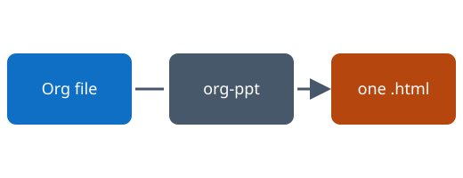

#+TITLE: org-ppt
#+SUBTITLE: Write the talk in Org, present it from one HTML file
#+AUTHOR: Your Name
#+EMAIL: you@example.com
#+DATE: 2026-09-01
#+OPTIONS: toc:t num:nil
#+ORG_PPT_THEME: light
#+ORG_PPT_ACCENT: #0F6FC5
#+ORG_PPT_ASPECT: 16:9
#+ORG_PPT_TRANSITION: fade
#+ORG_PPT_FOOTER: org-ppt demo deck
#+ORG_PPT_SLIDE_LEVEL: 2
# Shrink a slide that would otherwise overflow its frame.
#+ORG_PPT_AUTOFIT: t
# The title background is read straight out of a PowerPoint template.
#+ORG_PPT_TITLE_BG: brand.potx
#+ORG_PPT_TITLE_BG_DIM: 0.2
# Ctrl-P puts each slide's speaker notes under it on the handout.
#+ORG_PPT_PRINT_NOTES: t
# Resize the whole deck by hand instead of, or as well as, autofit:
# #+ORG_PPT_FONT_SCALE: 0.9

* Foundations

** What this is

One Org file in, one =.html= file out. Open it in any browser, press =f=, and
you are presenting. No server, no CDN, no runtime install on the machine that
shows the slides.

#+ATTR_PPT: :fragment t
- Stylesheet and runtime are inlined
- Images are embedded as data URIs
- The deck still works from a USB stick in an offline meeting room

#+BEGIN_NOTES
Speaker notes live here. Press =s= during the talk to open the notes panel
with the timer. The audience never sees this text.
#+END_NOTES

** The pipeline

#+CAPTION: From outline to deck

** Slide anatomy

A headline at the slide level becomes a slide. Anything deeper is content.

*** Deeper headlines become in-slide headings

And the text under them flows normally, with *bold*, /italic/ and =inline code=
all styled for legibility at the back of the room.

** Lists, one step at a time

Put =#+ATTR_PPT: :fragment t= before a list and it builds as you press space.

#+ATTR_PPT: :fragment t
1. First the problem
2. Then the constraint nobody stated
3. Then the design that falls out of it

* Content you actually present

** Code reads at the back of the room

#+BEGIN_SRC vhdl
process (clk) is
begin
  if rising_edge(clk) then
    if rst = '1' then
      count <= (others => '0');
    else
      count <= count + 1;
    end if;
  end if;
end process;
#+END_SRC

** Tables stay readable

| Stage        | Tool      | Output          |
|--------------+-----------+-----------------|
| Authoring    | Emacs Org | =talk.org=      |
| Export       | org-ppt   | =talk.html=     |
| Presentation | Browser   | fullscreen deck |
| Handout      | Ctrl+P    | PDF, 1 page/slide |

** Math needs no TeX

Inline math like $f_{\max} = 1/t_{\text{clk}}$ sits in the sentence, and a
display equation gets its own line:

\begin{equation}
t_{\text{setup}} + t_{\text{logic}} + t_{\text{skew}} \le T_{\text{clk}}
\end{equation}

KaTeX ships inside =org-ppt=. This slide was typeset at export time, so it
carries no script and no LaTeX, and renders offline on any machine.

** Two columns, headings and all

#+BEGIN_COLUMNS
#+BEGIN_COLUMN
*** Why a single file

A deck that depends on a folder of assets breaks the moment it is emailed.
Embedding removes that whole failure class.
#+END_COLUMN

#+BEGIN_COLUMN
*** What it costs

One file, a little larger. The figure beside this text is inside the =.html=
you are reading.
#+END_COLUMN
#+END_COLUMNS

#+BEGIN_NOTE
Both columns here start with a =***= headline. Org resolves outline structure
before block structure, so that used to end the slide's section, leave the
block unclosed, and print =#+BEGIN_COLUMNS= onto the slide as text.
#+END_NOTE

#+BEGIN_NOTES
This is the columns defect. Before the fix this slide rendered as a wall of
literal block markers with the underscores turned into subscripts.
#+END_NOTES

** Columns still hold anything else

#+BEGIN_COLUMNS
#+BEGIN_COLUMN
*** A list

- embedded as a data URI
- no folder of assets
- no network
#+END_COLUMN

#+BEGIN_COLUMN

#+END_COLUMN
#+END_COLUMNS

** Callouts and quotes

#+BEGIN_NOTE
Everything here is plain Org. Nothing in the source is HTML.
#+END_NOTE

#+BEGIN_WARNING
Embedding is on by default. A deck of 40 photographs will be a large file.
#+END_WARNING

#+BEGIN_QUOTE
The framework provides the mechanism, the project provides the facts.
#+END_QUOTE

** A full-bleed figure                                             :figure:

* Presenting

** Driving the deck

- =Space=, =→= advance a step; =←= goes back
- =f= fullscreen, =o= overview, =b= blank the screen
- =s= speaker notes and timer, =d= light/dark
- Type a number and press =Enter= to jump

#+BEGIN_FRAGMENT
=Ctrl+P= prints one page per slide, which is how you get the PDF handout.
#+END_FRAGMENT

*** Reminders                                                       :notes:

A =:notes:= subtree under a slide is speaker-only, exactly like a
=#+BEGIN_NOTES= block. Mention the offline story before the demo.

* Making the deck yours

** Driving it from a template

The title slide's background did not come from an image file. It was read out
of =brand.potx=, a PowerPoint template sitting next to this deck:

#+BEGIN_EXAMPLE
,#+ORG_PPT_TITLE_BG: brand.potx
,#+ORG_PPT_TITLE_BG_DIM: 0.2
#+END_EXAMPLE

org-ppt walks the package — first slide, then layout, then master — and takes
the largest picture it finds. That template also holds a small logo, which is
exactly the thing a naive "first image wins" would have picked instead.

=M-x org-ppt-list-pptx-images= lists what a template holds, and
=brand.potx::ppt/media/titleBackground.png= names one outright.

#+BEGIN_NOTES
Only the background picture is imported. Layouts, placeholders, fonts and text
stay in PowerPoint; =#+ORG_PPT_ACCENT= is how a deck matches a brand colour.
#+END_NOTES

** Text that fits the frame                                          :fit:

This slide carries more than a slide should, and the deck is exported with
=#+ORG_PPT_AUTOFIT: t=, so the runtime measures it and shrinks the type until
it fits rather than clipping whatever ran past the bottom edge. Every other
slide in this deck already fits, so every other slide is left alone at the
deck size — the deck does not drift into a dozen different type sizes.

Autofit only ever shrinks, and never below half the deck size, because a
slide nobody can read from the back of the room is not a fit. It measures
once the fonts and images have settled, which is why a slide that fits in a
fallback face still fits in the real one.

Set =#+ORG_PPT_FONT_SCALE: 0.9= to resize the whole deck by hand instead, or
put =:PPT_FONT_SCALE:= in a slide's property drawer to resize one slide. The
three are the same knob: autofit is the runtime turning it for you, and
=:fit:= or =:nofit:= on a headline overrules the deck-wide setting.

None of this is special markup. These are ordinary paragraphs on an ordinary
slide, and there are simply more of them than a 1280 by 720 frame holds at
26 px. Compare the type here with the slide that follows, which is set at the
deck size because it had room to spare.

Before this version the last two paragraphs of this slide were not smaller.
They were gone — clipped at the bottom edge, with nothing on screen and
nothing in the export to say that a third of the slide had been dropped.

#+BEGIN_NOTES
Compare this slide with the next one. Same deck, same keyword, and the next
slide is untouched because it already fitted.
#+END_NOTES

** A slide that already fits is left alone

Three lines. Autofit measured this slide, found nothing hanging over the
edge, and left it at the deck size.

#+BEGIN_NOTE
Before this version the previous slide simply lost its last paragraphs off
the bottom of the frame, with nothing on screen to say they were missing.
#+END_NOTE

** One slide, set smaller by hand
   :PROPERTIES:
   :PPT_FONT_SCALE: 0.62
   :END:

This slide carries =:PPT_FONT_SCALE: 0.62= in its property drawer, so it is
set at just under two thirds of the deck size while every other slide is
unchanged.

Useful for a dense table, a long code listing, or a wall of references you
want on one slide and do not expect the room to read from the back.

*** Everything scales together

Headings, body text, =inline code=, tables and captions are all fixed ratios
of one base size, so there is a single number to turn.

** Handouts carry the notes

=Ctrl+P= prints one page per slide. With =#+ORG_PPT_PRINT_NOTES: t= in the
header, each slide's speaker notes are printed in a band underneath it, so
the handout is the deck plus what you were going to say about it.

- the page grows to hold the band, so it is still one page per slide
- the screen presentation is untouched; the room never sees the notes
- raise =#+ORG_PPT_PRINT_NOTES_HEIGHT= for a talk with long notes

The page also follows the deck's own aspect ratio now. A =4:3= deck prints
=4:3= pages; it used to print =16:9= whatever the stage said.

#+BEGIN_NOTES
This note is the demonstration. Print this deck and it appears under this
slide, in a band with its own rule and label. Before this version the notes
existed only on screen and the handout had a blank half-page of nothing.
#+END_NOTES

** Thank you                                                      :section:

Questions?
